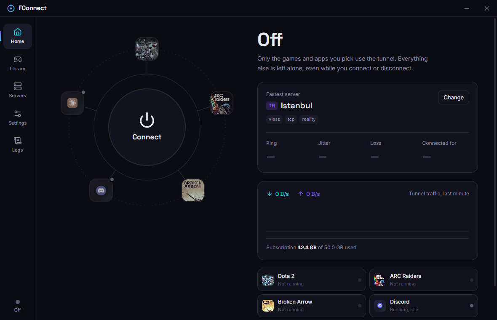
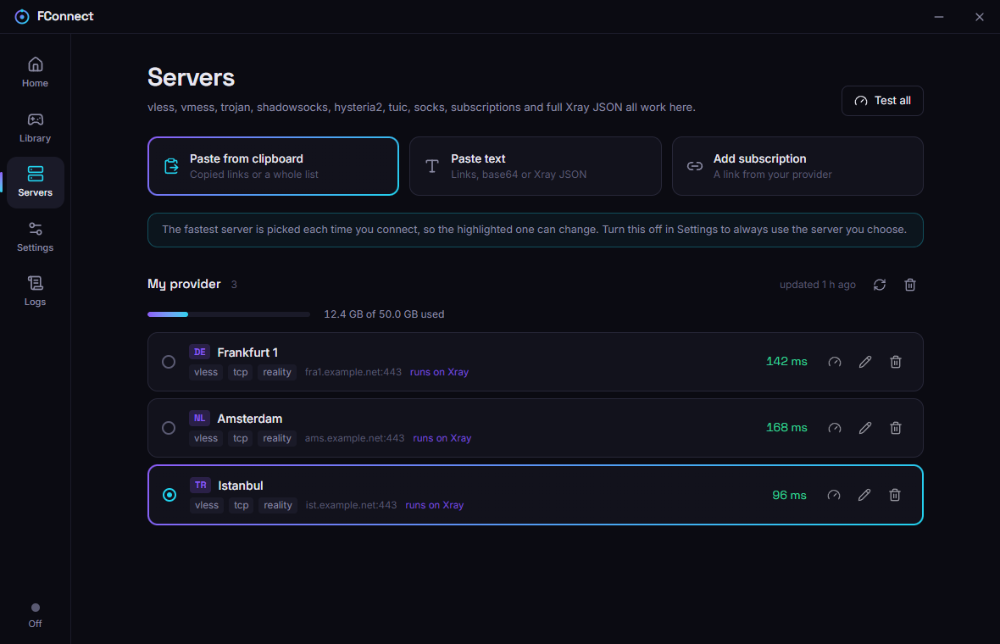
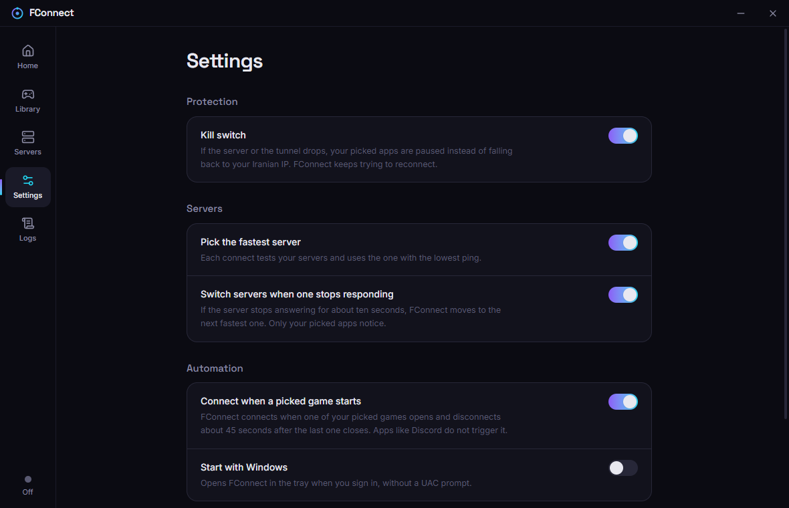

# FConnect

Send only the games and apps you pick through your v2ray / Xray server on Windows. Everything else, including voice chat and downloads you did not pick, stays on your normal connection and is never touched, not even while you connect or disconnect.



## Download

Get the latest build from [Releases](https://github.com/ebrahimhaghighat77/FConnect/releases):

- `FConnect-Setup-x.y.z.exe` installs FConnect for your Windows user.
- `FConnect-Portable-x.y.z.exe` runs without installing.

Windows 10 or 11, 64-bit.

## First run

1. **Allow administrator rights.** FConnect needs them to redirect individual apps.
2. **SmartScreen may warn you** because the build is not code-signed. Choose *More info* and then *Run anyway*.
3. **The first Connect installs the Windows Packet Filter driver** once. It can be removed later from Windows Settings > Apps.

## Using it

1. **Servers**: paste v2ray links from the clipboard, paste text or base64, add a subscription link, or paste a full Xray JSON config. *Test all* measures each server.
2. **Library**: tick the games and apps that should use the tunnel. Steam and Epic games, Discord, Claude and everything in your Start menu show up on their own. *Add app* covers anything else: an `.exe`, a whole folder, or a running program.
3. **Connect**. With *Connect when a picked game starts* turned on, FConnect connects by itself when one of your games opens.



## Features

- Per-app tunnel for TCP and UDP, so game traffic and voice chat work.
- Live traffic, data used and the servers each app talks to (click an app on Home).
- Ping, jitter and loss measured on an open connection, like game packets.
- Kill switch: if the server drops, picked apps pause instead of falling back to your real IP.
- Fastest-server selection, plus automatic failover when a server stops answering.
- Auto-connect when a picked game starts, and start with Windows.
- Every one of these can be switched off in Settings.



## Supported configs

- **vless, vmess, trojan**: REALITY, Vision, TLS, XHTTP, WebSocket, gRPC, HTTPUpgrade, mKCP and fragment.
- **shadowsocks** (including 2022 ciphers and plugins), **socks**.
- **hysteria2, tuic**.
- Subscription links in base64 or plain text, with data usage and expiry when the provider sends them.
- Full Xray JSON configs.

## Good to know

- **Apps that follow the Windows proxy setting** (Claude, Discord, Steam) go through whatever app set a system proxy, for example another VPN client in proxy mode. FConnect can't see that traffic and shows a warning. Turn the system proxy off in the other app, then restart those apps.
- **Don't quit or update FConnect during a match.** For a few seconds the game would use your real connection, and games that sign in through Epic Online Services can drop your session. Close the game first.
- **Ping is from this PC to your server.** The last hop, from your server to the game server, can only be measured on the server.
- **Anti-cheat**: tested with Easy Anti-Cheat games (Dota 2, ARC Raiders, Broken Arrow, ROB RUN). Stricter kernel anti-cheats such as Vanguard or FACEIT have not been tested.
- If the redirect driver's helper process itself crashes, there is a gap of about a second before FConnect restarts it.

## How it works

```
picked app ─► ProxiFyre (Windows Packet Filter driver) ─► Xray SOCKS (sniffing) ─► your server
other apps ─► normal connection, untouched
```

- **Xray-core** runs vless / vmess / trojan and full Xray JSON. Each picked app gets its own inbound, which is how traffic is counted per app.
- **sing-box** runs what Xray can't: hysteria2, tuic, shadowsocks, socks, plaintext vless, `allowInsecure` TLS and h2. Xray stays in front so sniffing and stats work the same.
- **ProxiFyre** redirects only the picked processes, by folder or exe name. IPv6 from picked apps is blocked so nothing leaks around the tunnel.
- Xray sniffing replaces poisoned DNS answers with the real TLS or QUIC domain, so filtered sites work without changing system DNS.

## Build from source

Requires Node.js 22 and Windows.

```bash
npm install
npm run cores
npm run icon
npm test
npm run dev
```

`npm run cores` downloads the pinned Xray, sing-box, ProxiFyre and driver releases from their official GitHub pages and checks each SHA-256 hash. Connecting needs an elevated terminal.

```bash
npm run dist
```

This produces `dist/FConnect-Setup-<version>.exe` and `dist/FConnect-Portable-<version>.exe`.

## License

FConnect's code is [MIT](LICENSE). The installers bundle Xray-core, sing-box, ProxiFyre and the Windows Packet Filter driver under their own licenses; see [THIRD_PARTY_NOTICES.md](THIRD_PARTY_NOTICES.md). FConnect is not affiliated with any of those projects.
